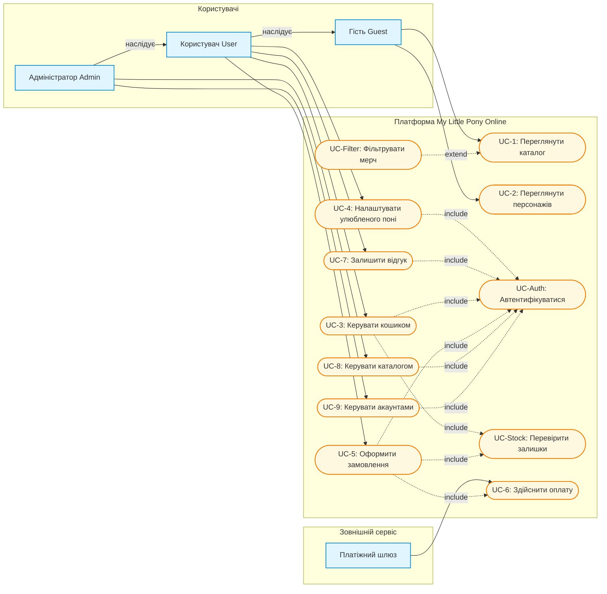

**Лабораторна робота №2**

# My Little Pony Online

## Опис проєкту
Фанатська платформа та інтернет-магазин мерчу за мотивами всесвіту *My Little Pony*. Платформа поєднує тематичний каталог персонажів і поколінь франшизи з функціоналом електронної комерції: каталогом товарів, категоріями, кошиком, оформленням замовлень та відгуками.

---

## Актори системи
У системі виділено чотири ролі акторів:
1. **Гість** — неавторизований користувач; має доступ до ознайомлення з каталогом мерчу, біографіями персонажів та поколіннями франшизи.
2. **Користувач** — зареєстрований покупець; може формувати кошик, оформлювати замовлення, налаштовувати улюбленого персонажа для персоналізації та залишати відгуки.
3. **Адміністратор** — системний адміністратор; керує асортиментом товарів, структурою категорій та здійснює модерацію акаунтів користувачів.
4. **Платіжний шлюз** — зовнішній сервіс для безпечного проведення безготівкових транзакцій.

---

## Діаграма прецедентів (Use Case Diagram)

Діаграма відображає основні сценарії використання, відношення наслідування між ролями акторів (`Admin --> User --> Guest`), обов'язкові включення (`include`) та опціональні розширення (`extend`):

