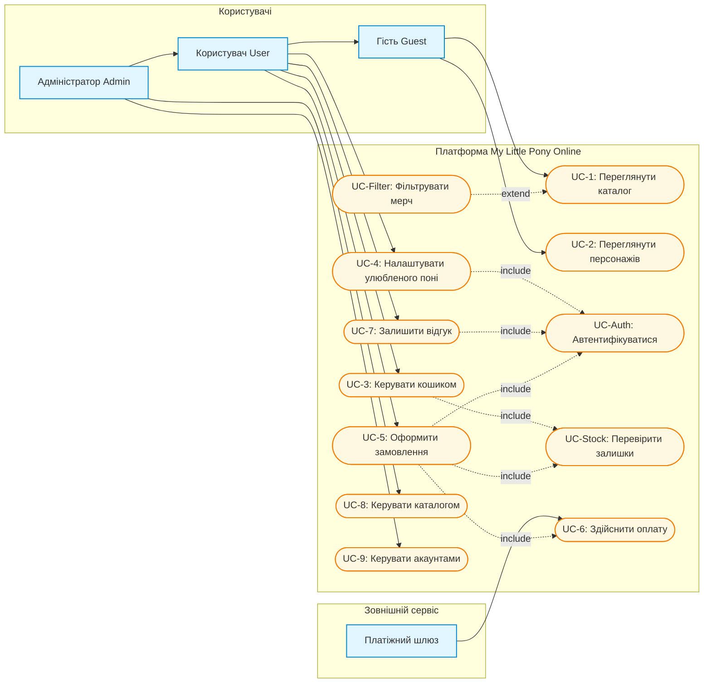

# Для платформи My Little Pony Online визначено такі типи акторів:

# Опис акторів системи та зовнішніх сервісів

- **Неавторизований користувач (Гість)**
  - **Ціль:** Ознайомлення з фанатською платформою, перегляд каталогу товарів, інформації про персонажів та покоління франшизи.
  - **Обмеження:** Не може купувати товари, залишати коментарі та оцінки.

- **Авторизований користувач (Покупець/Фанат)**
  - **Ціль:** Повний доступ до всіх функцій платформи.
  - **Можливості:** Оформлення замовлень, вибір улюбленого персонажа, залишення відгуків та рейтингових оцінок до товарів.

- **Адміністратор (Адміністратор системи)**
  - **Ціль:** Адміністрування та підтримка працездатності платформи та каталогів.
  - **Можливості:** Управління асортиментом товарів (додавання, редагування, вилучення), виправлення інформації про персонажів та категорії, модерація користувачів та управління їхніми правами доступу.

- **Платіжний шлюз (Payment Gateway)** — _Зовнішній сервіс_
  - **Ціль:** Забезпечення безпечної транзакції та передача підтвердження оплати платформі.

# EARS-вимоги:

_1. Ubiquitous (Універсальні вимоги)_

- **REQ-UB-1**: Система ПОВИННА зберігати облікові дані сутності користувача (`User`) та інформацію про товари (`Product`) у захищеному сховищі із застосуванням незворотного шифрування/хешування чутливих даних.
- **REQ-UB-2**: Система ПОВИННА забезпечувати глобальну унікальність ідентифікаторів (`UUIDv7`) та бізнес-ключів (`slug`, `sku`, `email`) для всіх сутностей платформи.
- **REQ-UB-3**: Система ПОВИННА автоматично вести системний аудит-лог усіх адміністративних дій з управління сутностями каталогу товарів і категорій.

  _2. Event-Driven (Подієві вимоги)_

- **REQ-ED-1**: КОЛИ користувач підтверджує оформлення замовлення, система ПОВИННА створити сутність `Order` зі статусом `'created'` та зафіксувати позиції `OrderItem`.
- **REQ-ED-2**: КОЛИ Платіжний шлюз надсилає підтвердження про успішне проведення оплати, система ПОВИННА оновити статус замовлення `Order` на `'paid'` та зменшити доступний залишок товару (`stock_quantity`) у сутності `Product`.
- **REQ-ED-3**: КОЛИ користувач надсилає форму відгуку про товар, система ПОВИННА створити сутність відгуку `Review` та пов'язати її з відповідними сутностями `Product` і `User`.
- **REQ-ED-4**: КОЛИ адміністратор змінює назву товару чи категорії, система ПОВИННА оновити відповідну сутність і згенерувати новий унікальний `slug`.

  _3. Unwanted Behaviours (Реакція на небажані події / Винятки)_

- **REQ-UW-1**: ЯКЩО товар повністю розпродано (`stock_quantity = 0`), ТО система ПОВИННА заблокувати елемент додавання в кошик та вивести візуальну мітку «Немає в наявності».
- **REQ-UW-2**: ЯКЩО платіжний шлюз повертає помилку транзакції або стається розрив з'єднання, ТО система ПОВИННА перевести сутність `Order` у статус `'cancelled'` ТА надати користувачеві можливість повторити спробу оплати.
- **REQ-UW-3**: ЯКЩО неавторизований користувач намагається отримати доступ до оформлення замовлення або написання відгуку, ТО система ПОВИННА перенаправити його на екран автентифікації.
- **REQ-UW-4**: ЯКЩО унікальний бізнес-ключ (`email` або `username`) вже існує в системі під час реєстрації, ТО система ПОВИННА повернути повідомлення про конфлікт дублювання даних.

_4. State-Driven (Вимоги, що залежать від стану системи)_

- **REQ-SD-1**: ПОКИ платіжний шлюз обробляє транзакцію, система ПОВИННА утримувати замовлення `Order` у стані очікування (`'created'`) та блокувати повторні запити на списання коштів.
- **REQ-SD-2**: ПОКИ акаунт користувача перебуває в статусі `'banned'`, система ПОВИННА блокувати йому будь-які можливості оформлення замовлень та залишення відгуків.
- **REQ-SD-3**: ПОКИ товар зарезервовано в активній сесії чекауту, система ПОВИННА утримувати резерв залишку на складі протягом 30 хвилин.

_5. Optional Features (Опціональні функції)_

- **REQ-OP-1**: ДЕ у профілі користувача обрано улюбленого персонажа (`favorite_character_id`), система ПОВИННА автоматично виводити в каталозі персоніфіковану добірку товарів, пов'язаних із цим персонажем.
- **REQ-OP-2**: ДЕ для категорії вказано батьківську категорію (`parent_category_id`), система ПОВИННА формувати багаторівневе ієрархічне дерево підкатегорій для навігації каталогом.
- **REQ-OP-3**: ДЕ користувач застосовує розширений фільтр поколінь франшизи (`Generation ↔ Character`), система ПОВИННА показувати персонажів та відповідний мерч за обраним кодовим позначенням покоління (наприклад, `G1`, `G4`, `G5`).

# User Stories і Gherkin-сценарії:

## 1. Для авторизованих користувачів

### Персоналізація профілю користувача

- **Як** зареєстрований користувач,
- **я хочу** обрати свого улюбленого персонажа у профілі,
- **щоб** бачити персоналізовані рекомендації та товари з ним.

 **Сценарій UC4-S1: Успішне збереження улюбленого персонажа**

- **Припустимо** користувач авторизований у системі
- **Коли** користувач у профілі обирає персонажа "Pinkie Pie" та натискає "Зберегти"
- **Тоді** система оновлює поле `favorite_character_id` у таблиці `User`
- **І** автоматично фільтрує товари в каталозі під обраного персонажа

---

### Додавання та зміна товарів у кошику

- **Як** покупець,
- **я хочу** додавати товари в кошик, змінювати їх кількість або видаляти зайве,
- **щоб** сформувати остаточне замовлення.

  **Сценарій UC3-S1: Додавання товару в кошик за умови наявності на складі**
  - **Припустимо** покупець переглядає сторінку товару з кількістю на складі `stock_quantity = 5`
  - **Коли** покупець натискає кнопку «Додати в кошик»
  - **Тоді** система додає товар до кошика користувача
  - **І** резервує його на складі протягом 30 хвилин

  **Сценарій UC3-S2: Заборона додавання розпроданого товару**
  - **Припустимо** товар має `stock_quantity = 0`
  - **Коли** покупець відкриває сторінку товару
  - **Тоді** система блокує кнопку «Додати в кошик»
  - **І** показує мітку «Немає в наявності»

  **Сценарій UC3-S3: Завершення резервування товару**
  - **Припустимо** товар перебуває в кошику, але замовлення не оформлене
  - **Коли** минає 30 хвилин від моменту резервування
  - **Тоді** система скасовує резервування
  - **І** повертає зарезервовану кількість до доступного залишку

---

### Оформлення замовлення покупцем

- **Як** покупець,
- **я хочу** підтвердити замовлення і перейти до оплати через зовнішній платіжний шлюз,
- **щоб** безпечно придбати обраний мерч.

  **Сценарій UC5-S1: Успішне створення замовлення**
  - **Припустимо** покупець має товари в кошику загальною сумою 1500 грн
  - **Коли** покупець натискає кнопку «Підтвердити замовлення»
  - **Тоді** система створює запис у таблиці `Order` зі статусом `'created'`
  - **І** перенаправляє користувача на платіжний шлюз для здійснення оплати

  **Сценарій UC5-S2: Успішне проведення оплати**
  - **Припустимо** замовлення має статус `'created'`, а платіжний шлюз обробляє транзакцію
  - **Коли** платіжний шлюз надсилає підтвердження про успішну оплату
  - **Тоді** система змінює статус замовлення на `'paid'`
  - **І** зменшує `stock_quantity` відповідних товарів на кількість замовлених позицій

  **Сценарій UC5-S3: Помилка проведення оплати**
  - **Припустимо** замовлення має статус `'created'`, а платіжний шлюз обробляє транзакцію
  - **Коли** платіжний шлюз повертає помилку транзакції або з'єднання
  - **Тоді** система змінює статус замовлення на `'cancelled'`
  - **І** не зменшує `stock_quantity`
  - **І** показує користувачеві дію «Повторити оплату»

---

### Написання відгуків та оцінювання товарів

- **Як** покупець,
- **я хочу** залишати текстові коментарі та оцінки (рейтинг) для придбаних товарів,
- **щоб** поділитися враженнями з іншими фанатами.

  **Сценарій UC7-S1: Додавання нового відгуку до товару**
  - **Припустимо** покупець авторизований і переглядає раніше придбаний товар
  - **Коли** покупець заповнює форму відгуку з текстом "Чудова фігурка!" та рейтингом `5`
  - **Тоді** система зберігає відгук у таблиці `Review`
  - **І** зв'язує його з `product_id` та `user_id` покупця

---

## 2. Для неавторизованих користувачів

### Перегляд каталогу товарів без авторизації

- **Як** гість платформи,
- **я хочу** переглядати список товарів і фільтрувати їх за категоріями,
- **щоб** знайти цікавий мерч без обов'язкової реєстрації.

  **Сценарій UC1-S1: Успішний перегляд каталогу та категорій**
  - **Припустимо** гість знаходиться на головній сторінці сайту
  - **Коли** гість обирає категорію "Фігурки та іграшки"
  - **Тоді** система відображає список товарів, що належать до цієї категорії
  - **І** не вимагає від гостя авторизації

  **Сценарій UC1-S2: Перегляд дерева підкатегорій**
  - **Припустимо** категорія «Іграшки» має дочірні категорії через `parent_category_id`
  - **Коли** гість відкриває категорію «Іграшки»
  - **Тоді** система показує категорію разом із її підкатегоріями
  - **І** відображає товари вибраної категорії та її підкатегорій

---

### Перегляд інформації про персонажів

- **Як** фанат франшизи,
- **я хочу** переглядати сторінки персонажів і дізнаватися їх біографію та типи поні,
- **щоб** краще зануритися у всесвіт My Little Pony.

  **Сценарій: Перегляд детальної інформації про персонажа**
  - **Припустимо** гість відкриває розділ персонажів
  - **Коли** гість обирає персонажа "Twilight Sparkle"
  - **Тоді** система показує біографію, опис к'ютімарки та тип поні (`Alicorn`)

  **Сценарій UC-Filter-S1: Фільтрація мерчу за поколінням**
  - **Припустимо** фільтр поколінь активний, а персонаж пов'язаний із поколінням `G4`
  - **Коли** гість обирає код покоління `G4`
  - **Тоді** система показує персонажів цього покоління
  - **І** показує пов'язаний із ними мерч

---

## 3. Для адміністраторів

### Адміністрування каталогу мерчу

- **Як** адміністратор,
- **я хочу** додавати нові товари, оновлювати їх ціну, опис та залишки на складі (`stock_quantity`),
- **щоб** каталог завжди був актуальним.

  **Сценарій UC8-S1: Додавання нового товару адміністратором**
  - **Припустимо** адміністратор увійшов до системи з правами доступу
  - **Коли** адміністратор заповнює дані нового товару (`name`, `price`, `stock_quantity`, `sku`) і натискає «Створити»
  - **Тоді** система зберігає товар у базі даних та автоматично генерує унікальний `slug`

  **Сценарій UC8-S2: Оновлення назви товару**
  - **Припустимо** адміністратор має права на редагування товару з назвою "Фігурка Twilight Sparkle"
  - **Коли** адміністратор змінює назву товару на "Фігурка Twilight Sparkle Alicorn"
  - **Тоді** система оновлює запис товару
  - **І** генерує новий унікальний `slug` на основі нової назви

  **Сценарій UC8-S3: Оновлення назви категорії**
  - **Припустимо** адміністратор має права на редагування категорії «Фігурки»
  - **Коли** адміністратор змінює назву категорії на «Фігурки та іграшки»
  - **Тоді** система оновлює запис категорії
  - **І** генерує новий унікальний `slug` на основі нової назви

---

### Управління статусами акаунтів

- **Як** адміністратор,
- **я хочу** керувати статусами замовлень та акаунтів користувачів (наприклад, банити порушників),
- **щоб** забезпечувати порядок на платформі.

  **Сценарій UC9-S1: Зміна статусу користувача на заборонений**
  - **Припустимо** адміністратор відкриває профіль порушника правил
  - **Коли** адміністратор змінює статус акаунта на `'banned'`
  - **Тоді** система оновлює статус у таблиці `User`
  - **І** блокує користувачеві можливість оформлювати нові замовлення чи залишати відгуки

### Автентифікація та обробка помилок

**Сценарій UC-Auth-S1: Доступ гостя до захищеної функції**

- **Припустимо** гість не авторизований у системі
- **Коли** гість відкриває сторінку оформлення замовлення або форму відгуку
- **Тоді** система перенаправляє його на сторінку автентифікації

**Сценарій UC-Auth-S2: Дублювання облікових даних**

- **Припустимо** у системі вже існує обліковий запис із вказаним `email` або `username`
- **Коли** користувач надсилає форму реєстрації з таким самим унікальним ключем
- **Тоді** система не створює дубльований обліковий запис
- **І** показує повідомлення про помилку дублювання даних

# Use Case діаграма

# Матриця трасування вимог до сценаріїв користувача

| ID вимоги    | EARS Патерн  |   Тип   | Короткий зміст вимоги                                                                | Use Cases (UC)            | Сценарії Gherkin / User Stories                    | Статус покриття      |
| :----------- | :----------- | :-----: | :----------------------------------------------------------------------------------- | :------------------------ | :------------------------------------------------- | :------------------- |
| **REQ-UB-1** | Ubiquitous   | **НФВ** | Хешування паролів та шифрування бази                                                 | `UC_Auth`                 | —                                                  | _Не покрито_         |
| **REQ-UB-2** | Ubiquitous   | **НФВ** | Унікальність UUIDv7, `username`, `email`, `slug`, `sku`, `code_name`, `order_number` | `UC5`, `UC8`, `UC-Auth`   | `UC5-S1`, `UC8-S1`, `UC-Auth-S2`                   | **Покрито частково** |
| **REQ-UB-3** | Ubiquitous   | **НФВ** | Автоматичне логування дій адміністратора                                             | —                         | —                                                  | _Не покрито_         |
| **REQ-ED-1** | Event-Driven | **ФВ**  | Створення `Order` зі статусом `'created'`                                            | `UC5`                     | Сценарій: Успішне створення замовлення             | **Покрито**          |
| **REQ-ED-2** | Event-Driven | **ФВ**  | Оновлення на `'paid'` та списання залишку                                            | `UC5`, `UC6`              | `UC5-S2: Успішне проведення оплати`                | **Покрито**          |
| **REQ-ED-3** | Event-Driven | **ФВ**  | Збереження відгуку `Review`                                                          | `UC7`                     | Сценарій: Додавання нового відгуку до товару       | **Покрито**          |
| **REQ-ED-4** | Event-Driven | **ФВ**  | Автогенерація нового `slug` при зміні назви товару або категорії                     | `UC8`                     | `UC8-S2`, `UC8-S3`                                 | **Покрито**          |
| **REQ-UW-1** | Unwanted     | **ФВ**  | Блокування кнопки при `stock_quantity = 0`                                           | `UC3`, `UC_Stock`         | `UC3-S2`                                           | **Покрито**          |
| **REQ-UW-2** | Unwanted     | **ФВ**  | Скасування замовлення без списання залишку та показ дії повторної оплати             | `UC5`, `UC6`              | `UC5-S3`                                           | **Покрито**          |
| **REQ-UW-3** | Unwanted     | **ФВ**  | Редирект гостя на автентифікацію                                                     | `UC5`, `UC7`, `UC_Auth`   | `UC-Auth-S1: Доступ гостя до захищеної функції`    | **Покрито**          |
| **REQ-UW-4** | Unwanted     | **ФВ**  | Помилка дублювання `email`/`username`                                                | `UC_Auth`                 | `UC-Auth-S2: Дублювання облікових даних`           | **Покрито**          |
| **REQ-SD-1** | State-Driven | **НФВ** | Утримання замовлення у стані `'created'` до відповіді шлюзу                          | `UC5`, `UC6`              | `UC5-S2`, `UC5-S3`                                 | **Покрито**          |
| **REQ-SD-2** | State-Driven | **ФВ**  | Блокування дій для користувача `'banned'`                                            | `UC5`, `UC7`, `UC9`       | Сценарій: Зміна статусу користувача на заборонений | **Покрито**          |
| **REQ-SD-3** | State-Driven | **НФВ** | Резервування залишку на 30 хвилин і скасування резерву після строку                  | `UC3`, `UC_Stock`         | `UC3-S1`, `UC3-S3`                                 | **Покрито**          |
| **REQ-OP-1** | Optional     | **ФВ**  | Персоналізація за `favorite_character_id`                                            | `UC1`, `UC4`              | Сценарій: Успішне збереження улюбленого персонажа  | **Покрито**          |
| **REQ-OP-2** | Optional     | **ФВ**  | Дерево підкатегорій `parent_category_id`                                             | `UC1`                     | `UC1-S1`, `UC1-S2`                                 | **Покрито**          |
| **REQ-OP-3** | Optional     | **ФВ**  | Фільтрація мерчу за поколіннями                                                      | `UC1`, `UC2`, `UC_Filter` | `UC2-S1`, `UC-Filter-S1`                           | **Покрито**          |

## <!-- ФВ- функціональні умови, НФВ - нефункціональні умови -->

### Аналіз покриття та обґрунтування непокритих вимог:

- REQ-UB-1 (Шифрування бази та хешування паролів): Не покрита окремим користувацьким сценарієм, оскільки є нефункціональною архітектурною вимогою до рівня збереження даних.
- REQ-UB-3 (Аудит адміністративних дій): Не покрита окремим Use Case або Gherkin-сценарієм, оскільки логування операцій виконується автоматично у фоновому режимі на рівні бекенду/middleware без безпосередньої участі інтерфейсу користувача чи адміністратора.
- REQ-UW-2, REQ-UW-3, REQ-UW-4 (Обробка виняткових ситуацій): Покриті окремими негативними Gherkin-сценаріями `UC5-S3`, `UC-Auth-S1` та `UC-Auth-S2`.
