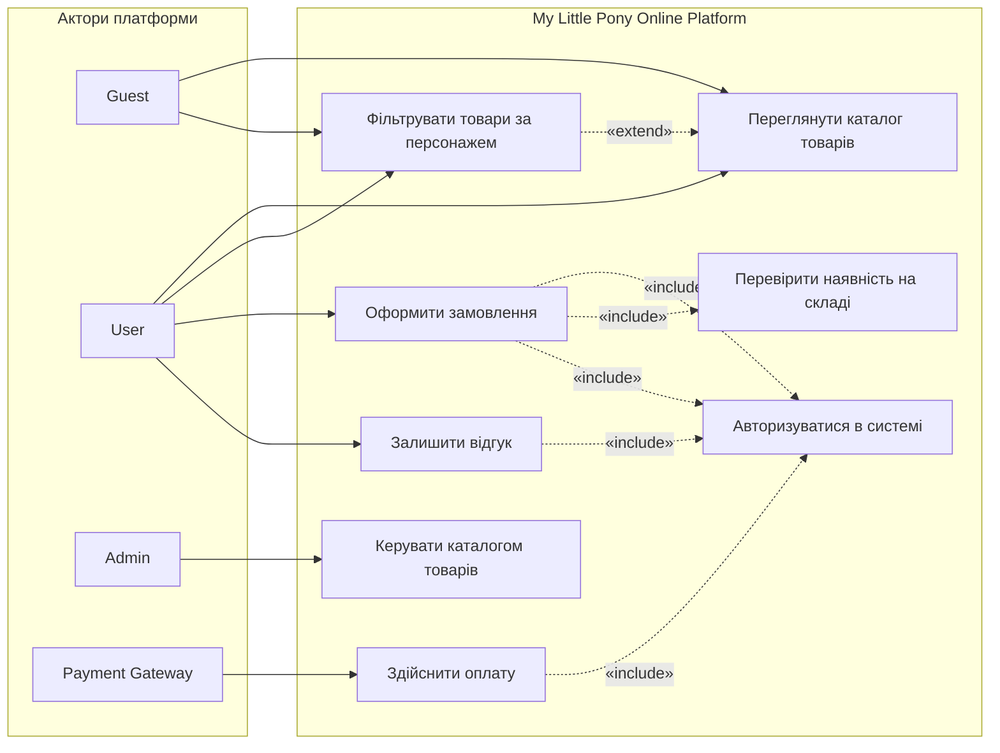

# Для платформи My Little Pony Online визначено такі типи акторів:
   # Опис акторів системи та зовнішніх сервісів

* **Неавторизований користувач (Гість)**
  * **Ціль:** Ознайомлення з фанатською платформою, перегляд каталогу товарів, інформації про персонажів та покоління франшизи.
  * **Обмеження:** Не може купувати товари, залишати коментарі та оцінки, а також брати участь у форумах спільноти.

* **Авторизований користувач (Покупець/Фанат)**
  * **Ціль:** Повний доступ до всіх функцій платформи.
  * **Можливості:** Оформлення замовлень, вибір улюбленого персонажа, залишення відгуків та рейтингових оцінок до товарів, а також участь у форумах та фанатських обговореннях.

* **Адміністратор (Адміністратор системи)**
  * **Ціль:** Адміністрування та підтримка працездатності платформи та каталогів.
  * **Можливості:** Управління асортиментом товарів (додавання, редагування, вилучення), виправлення інформації про персонажів та категорії, модерація користувачів та управління їхніми правами доступу.

* **Платіжний шлюз (Payment Gateway)** — *Зовнішній сервіс*
  * **Ціль:** Забезпечення безпечної транзакції та передача підтвердження оплати платформі.

# EARS-вимоги:
   1. Ubiquitous(Універсальні вимоги)
       * Вимоги 1: Система ПОВИННА зберігати всі облікові дані користувачів (User) та інформацію про товари (Product) у зашифрованій реляційній базі даних.
       * Вимога 2: Система ПОВИННА забезпечувати унікальність ідентифікаторів (UUIDv7) та унікальних ключів (slug, sku, email) для всіх сутностей платформи.
       * Вимога 3: Система ПОВИННА автоматично логуватиме всі адміністративні дії з управління каталогом товарів і категоріями. 
   2. Event-Driven (Подіїві вимоги)
      * Вимога 1: КОЛИ користувач натискає кнопку «Підтвердити замовлення», система ПОВИННА створити запис у таблиці Order зі статусом 'created'та заблокувати позиції в OrderItem.
      * Вимоги 2: КОЛИ Платіжний шлюз надсилає підтвердження про успішне проведення оплати, система ПОВИННА оновити статус замовлення на 'paid' та зменшити кількість товару на складі (stock_quantity) Product.
      * Вимога 3: КОЛИ користувач надсилає форму відгуку про товар (Review), система ПОВИННА зберегти його в базі даних та зв'язати з відповідним product_idі user_id.
      * Вимога 4: КОЛИ адміністратор змінює статус товару чи категорії, система ПОВИННА оновити відповідний запис і згенерувати новий slug у разі зміни назви. 
   3. Unwanted Behaviours (Реакція на небажані події / Винятки)
      * Вимога 1: ЯКЩО товар повністю розпродано (stock_quantity = 0), ТО система ПОВИННА заблокувати кнопку «Додати в кошик» та вивести візуальну мітку «Немає в наявності».
      * Вимога 2: ЯКЩО платіжний шлюз повертає помилку транзакції або помилка з'єднання, ТО система ПОВИННА повернути замовлення в статус 'cancelled'або надати користувачеві можливість повторити оплату.
      * Вимога 3: ЯКЩО неавторизований користувач намагається отримати доступ до оформлення замовлення або написання відгуку, ТО система ПОВИННА перенаправити його на сторінку автентифікації.
      * Вимога 4: ЯКЩО унікальний ключ (emailабо username) вже існує в системі під час реєстрації, ТО система ПОВИННА вивести повідомлення про помилку дублювання даних.
   4. State-Driven (Вимоги, що залежать від стану системи)
      * Вимога 1: ПОКИ платіжний шлюз обробляє транзакцію, система ПОВИННА утримувати відповідний замовлення в стані очікування (created).
      * Вимога 2: ПОКИ аккаунт користувача перебуває в статусі 'banned', система ПОВИННА блокувати йому будь-які можливості оформлення замовлень та залишення коментарів
      * Вимога 3: ПОКИ товар знаходиться в кошику користувача, але замовлення не оформлене, система ПОВИННА резервувати його на складі протягом 30 хвилин.
   5. Optional Features (Опціональні функції)
      * Вимога 1: ДЕ у профілі користувача активовано вибір улюбленого персонажа ( favorite_character_id), система ПОВИННА автоматично фільтрувати та виводити в каталозі товари, пов'язані з цим персонажем.
      * Вимога 2: ДЕ підключено модуль батьківських категорій ( parent_category_id), система ПОВИННА formувати багаторівневе дерево підкатегорій для фільтрації мерчу.
      * Вимога 3: ДЕ активовано розширений фільтр поколінь франшизи ( Generation ↔ Character), система ПОВИННА показувати персонажів та відповідний мерч за обраним кодовим ім'ям (наприклад, G4, G5).

# User Stories і Gherkin-сценарії:

## 1. Для авторизованих користувачів

### Персоналізація профілю користувача
* **Як** зареєстрований користувач,
* **я хочу** обрати свого улюбленого персонажа у профілі,
* **щоб** бачити персоналізовані рекомендації та товари з ним.

> **Сценарій: Успішне збереження улюбленого персонажа**
  * **Припустимо** користувач авторизований у системі
  * **Коли** користувач у профілі обирає персонажа "Pinkie Pie" та натискає "Зберегти"
  * **Тоді** система оновлює поле `favorite_character_id` у таблиці `User`
  * **І** автоматично фільтрує товари в каталозі під обраного персонажа

---

### Додавання та зміна товарів у кошику
* **Як** покупець,
* **я хочу** додавати товари в кошик, змінювати їх кількість або видаляти зайве,
* **щоб** сформувати остаточне замовлення.

  **Сценарій: Додавання товару в кошик за умови наявності на складі**
  * **Припустимо** покупець переглядає сторінку товару з кількістю на складі `stock_quantity = 5`
  * **Коли** покупець натискає кнопку «Додати в кошик»
  * **Тоді** система додає товар до кошика користувача
  * **І** резервує його на складі протягом 30 хвилин

---

### Оформлення замовлення покупцем
* **Як** покупець,
* **я хочу** підтвердити замовлення і перейти до оплати через зовнішній платіжний шлюз,
* **щоб** безпечно придбати обраний мерч.

  **Сценарій: Успішне створення замовлення**
  * **Припустимо** покупець має товари в кошику загальною сумою 1500 грн
  * **Коли** покупець натискає кнопку «Підтвердити замовлення»
  * **Тоді** система створює запис у таблиці `Order` зі статусом `'created'`
  * **І** перенаправляє користувача на платіжний шлюз для здійснення оплати

---

### Написання відгуків та оцінювання товарів
* **Як** покупець,
* **я хочу** залишати текстові коментарі та оцінки (рейтинг) для придбаних товарів,
* **щоб** поділитися враженнями з іншими фанатами.

  **Сценарій: Додавання нового відгуку до товару**
  * **Припустимо** покупець авторизований і переглядає раніше придбаний товар
  * **Коли** покупець заповнює форму відгуку з текстом "Чудова фігурка!" та рейтингом `5`
  * **Тоді** система зберігає відгук у таблиці `Review`
  * **І** зв'язує його з `product_id` та `user_id` покупця

---

## 2. Для неавторизованих користувачів

### Перегляд каталогу товарів без авторизації
* **Як** гість платформи,
* **я хочу** переглядати список товарів і фільтрувати їх за категоріями,
* **щоб** знайти цікавий мерч без обов'язкової реєстрації.

  **Сценарій: Успішний перегляд каталогу та категорій**
  * **Припустимо** гість знаходиться на головній сторінці сайту
  * **Коли** гість обирає категорію "Фігурки та іграшки"
  * **Тоді** система відображає список товарів, що належать до цієї категорії
  * **І** не вимагає від гостя авторизації

---

### Перегляд інформації про персонажів
* **Як** фанат франшизи,
* **я хочу** переглядати сторінки персонажів і дізнаватися їх біографію та типи поні,
* **щоб** краще зануритися у всесвіт My Little Pony.

  **Сценарій: Перегляд детальної інформації про персонажа**
  * **Припустимо** гість відкриває розділ персонажів
  * **Коли** гість обирає персонажа "Twilight Sparkle"
  * **Тоді** система показує біографію, опис к'ютімарки та тип поні (`Alicorn`)

---

## 3. Для адміністраторів

### Адміністрування каталогу мерчу
* **Як** адміністратор,
* **я хочу** додавати нові товари, оновлювати їх ціну, опис та залишки на складі (`stock_quantity`),
* **щоб** каталог завжди був актуальним.

  **Сценарій: Додавання нового товару адміністратором**
  * **Припустимо** адміністратор увійшов до системи з правами доступу
  * **Коли** адміністратор заповнює дані нового товару (`name`, `price`, `stock_quantity`, `sku`) і натискає «Створити»
  * **Тоді** система зберігає товар у базі даних та автоматично генерує унікальний `slug`

---

### Управління статусами акаунтів
* **Як** адміністратор,
* **я хочу** керувати статусами замовлень та акаунтів користувачів (наприклад, банити порушників),
* **щоб** забезпечувати порядок на платформі.

  **Сценарій: Зміна статусу користувача на заборонений**
  * **Припустимо** адміністратор відкриває профіль порушника правил
  * **Коли** адміністратор змінює статус акаунта на `'banned'`
  * **Тоді** система оновлює статус у таблиці `User`
  * **І** блокує користувачеві можливість оформлювати нові замовлення чи залишати відгуки

# Use Case діаграма

