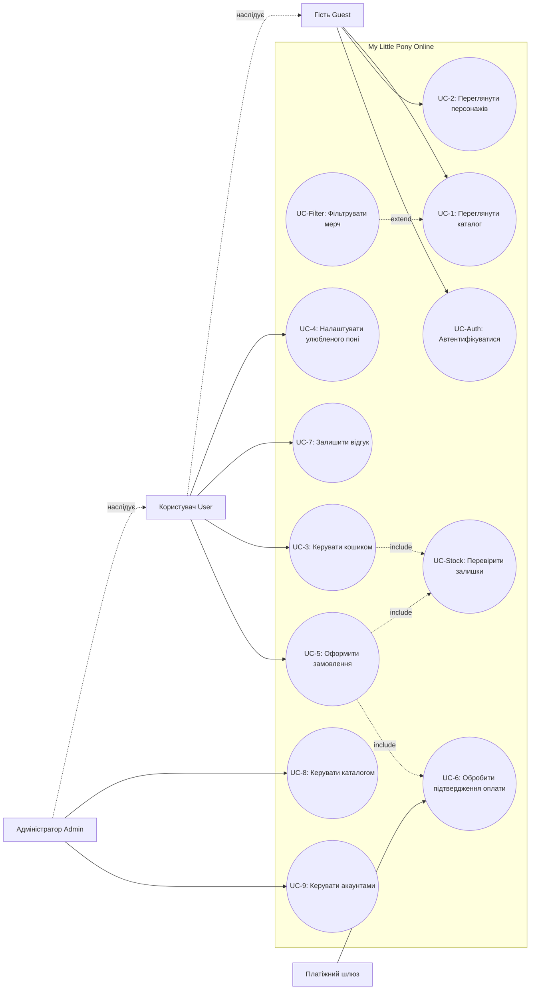

# Для платформи My Little Pony Online визначено такі типи акторів:

# Опис акторів системи та зовнішніх сервісів

- **Неавторизований користувач (Гість)**
  - **Ціль:** Ознайомлення з фанатською платформою, перегляд каталогу товарів, інформації про персонажів та покоління франшизи.
  - **Обмеження:** Не може купувати товари, залишати коментарі та оцінки.

- **Авторизований користувач (Покупець/Фанат)**
  - **Ціль:** Повний доступ до всіх функцій платформи.
  - **Можливості:** Оформлення замовлень, вибір улюбленого персонажа, залишення відгуків та рейтингових оцінок до товарів.
  - **Обмеження:** Не може здійснювати дії, якщо його акаунт перебуває у статусі `'banned'`.

- **Адміністратор (Адміністратор системи)**
  - **Ціль:** Адміністрування та підтримка працездатності платформи та каталогів.
  - **Можливості:** Управління асортиментом товарів (додавання, редагування, вилучення), виправлення інформації про персонажів та категорії, модерація користувачів та управління їхніми правами доступу.
  - **Обмеження:** Доступ до адміністративних функцій лише при наявності відповідних прав.

- **Платіжний шлюз (Payment Gateway)** — _Зовнішній сервіс_
  - **Ціль:** Забезпечення безпечної транзакції та передача підтвердження оплати платформі.
  - **Обмеження:** Використовується лише в процесі оформлення замовлення.
  
# Сутності та статуси (узгоджено з ERD)

- `Order.status`: `'created'` → `'paid'` або `'cancelled'`. Переходи в `'shipped'` і `'completed'`.
- `User.status`: `'active'`, `'banned'`. Статус `'inactive'`.
- Кошик, резерв залишку, журнал аудиту та запис транзакції шлюзу не є доменними сутностями ERD. Вони описані як технічні стани й записи.

# EARS-вимоги:

_1. Ubiquitous (Універсальні вимоги)_

- **REQ-UB-1**(НФВ): Система ПОВИННА зберігати паролі користувачів (`User.password_hash`) як незворотні хеші, а облікові дані користувачів і товари (`User`, `Product`) — у захищеному сховищі з шифруванням даних.
- **REQ-UB-2**(НФВ): Система ПОВИННА забезпечувати глобальну унікальність ідентифікаторів (`UUIDv7`) та бізнес-ключів `username`, `email`, `slug`, `sku`, `code_name` і `order_number` відповідно до моделі даних.
- **REQ-UB-3**(НФВ): Система ПОВИННА автоматично вести журнал аудиту всіх адміністративних дій з товарами і категоріями.
- **REQ-UB-4**: Система ПОВИННА відображати для кожного товару в каталозі назву, ціну, категорію та поточний `stock_quantity`; при `stock_quantity = 0` товар відображається з міткою «Немає в наявності».
- **REQ-UB-5**: Система ПОВИННА прив'язувати кошик до `User.id` авторизованого користувача і зберігати його між сесіями (після виходу та повторного входу). Резерв залишку не зберігається між сесіями і діє лише згідно з REQ-SD-3; після його закінчення позиція залишається в кошику без резерву, а наявність перевіряється повторно згідно з REQ-UW-6. Гостьовий кошик не ведеться. Кошик є технічним станом і не є доменною сутністю ERD.
- **REQ-UB-6**(НФВ): Система ПОВИННА бути орієнтована на фанатів франшизи My Little Pony, гостей каталогу, авторизованих покупців мерчу та адміністраторів; інтерфейс і доступні функції ПОВИННІ відповідати цілям та правам кожної ролі.
- **REQ-UB-7**(НФВ): Система ПОВИННА підтримувати одночасну роботу щонайменше 1 000 користувацьких сесій, зберігати щонайменше 1 000 зареєстрованих облікових записів, 10 000 товарів і 100 000 замовлень без втрати даних та доступності основних функцій.
- **REQ-UB-8**(НФВ): За навантаження до 1 000 одночасних сесій система ПОВИННА формувати відповідь для перегляду каталогу, сторінки товару та кошика не довше 2 секунд; час відповіді платіжного шлюзу до цього обмеження не входить.
- **REQ-UB-9**(НФВ): За одночасних операцій із тим самим товаром система ПОВИННА гарантувати узгодженість резервування та не допускати оформлення замовлень на кількість, що перевищує доступний залишок.

  _2. Event-Driven (Подієві вимоги)_

- **REQ-ED-1**: КОЛИ користувач підтверджує оформлення замовлення, система ПОВИННА створити сутність `Order` зі статусом `'created'` та зафіксувати позиції `OrderItem`.
- **REQ-ED-2**: КОЛИ Платіжний шлюз надсилає підтвердження про успішне проведення оплати, система ПОВИННА оновити статус замовлення `Order` на `'paid'` та зменшити доступний залишок товару (`stock_quantity`) у сутності `Product`.
- **REQ-ED-3**: КОЛИ користувач надсилає форму відгуку про товар, система ПОВИННА створити сутність відгуку `Review` та пов'язати її з відповідними сутностями `Product` і `User`.
- **REQ-ED-4**: КОЛИ адміністратор змінює назву товару, система ПОВИННА оновити сутність `Product` і згенерувати новий унікальний `slug`.
- **REQ-ED-5**: КОЛИ гість обирає персонажа, система ПОВИННА показати сторінку персонажа: біографію, опис к'ютімарки та тип поні.
- **REQ-ED-6**: КОЛИ гість обирає категорію, система ПОВИННА показати список товарів цієї категорії без вимоги авторизації.
- **REQ-ED-7**: КОЛИ авторизований покупець натискає «Додати в кошик» для товару з `stock_quantity > 0`, система ПОВИННА додати позицію до кошика та зарезервувати запитану кількість на складі.
- **REQ-ED-8**: КОЛИ покупець змінює кількість позиції в кошику на значення, що не перевищує доступний залишок, система ПОВИННА оновити кількість позиції, перерахувати суму кошика та скоригувати резерв.
- **REQ-ED-9**: КОЛИ покупець видаляє позицію з кошика, система ПОВИННА вилучити її з кошика та повернути зарезервовану кількість до доступного залишку.
- **REQ-ED-10**: КОЛИ покупець відкриває кошик, система ПОВИННА показати всі позиції з назвою, ціною, кількістю, сумою за позицію та загальною сумою кошика.
- **REQ-ED-11**: КОЛИ неавторизований користувач, який намагався додати товар у кошик, успішно автентифікується, система ПОВИННА повернути його на сторінку того товару.
- **REQ-ED-12**: КОЛИ гість відкриває сторінку товару, система ПОВИННА показати назву, ціну, опис, наявність і кнопку «Додати в кошик»; для гостя ця кнопка веде на автентифікацію.
- **REQ-ED-13**: КОЛИ адміністратор змінює назву категорії, система ПОВИННА оновити сутність `Category` і згенерувати новий унікальний `slug`.

  _3. Unwanted Behaviours (Реакція на небажані події / Винятки)_

- **REQ-UW-1**: ЯКЩО товар повністю розпродано (`Product.stock_quantity = 0`), ТО система ПОВИННА заблокувати елемент додавання в кошик та вивести мітку «Немає в наявності».
- **REQ-UW-2**: ЯКЩО платіжний шлюз повертає помилку транзакції, ТО система ПОВИННА перевести сутність `Order` у статус `'cancelled'` ТА надати користувачеві можливість повторити спробу оплати.
- **REQ-UW-3**: ЯКЩО неавторизований користувач намагається отримати доступ до оформлення замовлення, ТО система ПОВИННА перенаправити його на екран автентифікації.
- **REQ-UW-4**: ЯКЩО значення `email` вже існує в системі під час реєстрації, ТО система ПОВИННА повернути повідомлення про конфлікт дублювання даних.
- **REQ-UW-5**: ЯКЩО запитана кількість товару перевищує `stock_quantity` під час додавання до кошика, ТО система ПОВИННА відхилити додавання, зберегти попередній стан кошика та показати повідомлення про недостатню кількість.
- **REQ-UW-6**: ЯКЩО під час підтвердження замовлення доступний залишок товару менший за кількість у кошику, ТО система ПОВИННА відхилити оформлення замовлення та показати покупцеві розбіжність у позиціях.
- **REQ-UW-7**: ЯКЩО під час оплати стається розрив з'єднання з платіжним шлюзом, ТО система ПОВИННА перевести сутність `Order` у статус `'cancelled'` ТА надати користувачеві можливість повторити спробу оплати.
- **REQ-UW-8**: ЯКЩО неавторизований користувач намагається отримати доступ до написання відгуку, ТО система ПОВИННА перенаправити його на екран автентифікації.
- **REQ-UW-9**: ЯКЩО значення `username` вже існує в системі під час реєстрації, ТО система ПОВИННА повернути повідомлення про конфлікт дублювання даних.
- **REQ-UW-10**: ЯКЩО нова кількість товару перевищує `stock_quantity` під час зміни позиції в кошику, ТО система ПОВИННА відхилити зміну, зберегти попередній стан кошика та показати повідомлення про недостатню кількість.

_4. State-Driven (Вимоги, що залежать від стану системи)_

- **REQ-SD-1**(НФВ): ПОКИ платіжний шлюз обробляє транзакцію, система ПОВИННА утримувати замовлення `Order` у стані очікування (`'created'`) та блокувати повторні запити на списання коштів.
- **REQ-SD-2**: ПОКИ акаунт користувача перебуває в статусі `'banned'`, система ПОВИННА блокувати йому будь-які можливості оформлення замовлень та залишення відгуків.
- **REQ-SD-3**(НФВ): ПОКИ товар зарезервовано в активній сесії чекауту, система ПОВИННА утримувати резерв залишку на складі не довше 30 хвилин, а після завершення цього строку скасувати резервування та повернути кількість до доступного залишку.

_5. Optional Features (Опціональні функції)_

- **REQ-OP-1**:  ДЕ у профілі обрано `User.favorite_character_id`, система ПОВИННА в каталозі показувати товари, пов'язані з цим персонажем.
- **REQ-OP-2**: ДЕ для категорії вказано батьківську категорію (`parent_category_id`), система ПОВИННА показувати дерево підкатегорій разом з їхніми товарами.
- **REQ-OP-3**: ДЕ користувач застосовує розширений фільтр поколінь франшизи, система ПОВИННА показувати персонажів та відповідний мерч за обраним кодовим позначенням покоління (наприклад, `G1`, `G4`, `G5`).

# User Stories і Gherkin-сценарії:

## 1. Для авторизованих користувачів

### Персоналізація профілю користувача

- **Як** зареєстрований користувач,
- **я хочу** обрати свого улюбленого персонажа у профілі,
- **щоб** бачити персоналізовані рекомендації та товари з ним.

 **Сценарій UC4-S1: Успішне збереження улюбленого персонажа**

- **Припустимо** користувач авторизований у системі
- **Коли** користувач у профілі обирає персонажа "Pinkie Pie" та натискає "Зберегти"
- **Тоді** система оновлює поле `favorite_character_id` у таблиці `User`
- **І** автоматично фільтрує товари в каталозі під обраного персонажа

---

### Додавання та зміна товарів у кошику

- **Як** покупець,
- **я хочу** додавати товари в кошик, змінювати їх кількість або видаляти зайве,
- **щоб** сформувати остаточне замовлення.

  **Сценарій UC3-S1: Додавання товару в кошик за умови наявності на складі**
  - **Припустимо** покупець переглядає сторінку товару з кількістю на складі `stock_quantity = 5`
  - **Коли** покупець натискає кнопку «Додати в кошик»
  - **Тоді** система додає товар до кошика користувача
  - **І** резервує його на складі протягом 30 хвилин

  **Сценарій UC3-S2: Заборона додавання розпроданого товару**
  - **Припустимо**  користувач авторизований і обрав товар, який має `stock_quantity = 0`
  - **Коли** покупець відкриває сторінку товару
  - **Тоді** система блокує кнопку «Додати в кошик»
  - **І** показує мітку «Немає в наявності»

  **Сценарій UC3-S3: Завершення резервування товару**
  - **Припустимо** товар перебуває в кошику, але замовлення не оформлене
  - **Коли** минає 30 хвилин від моменту резервування
  - **Тоді** система скасовує резервування
  - **І** повертає зарезервовану кількість до доступного залишку
  **Сценарій UC3-S4: Зміна кількості товару в кошику в межах залишку**
  - **Припустимо** покупець авторизований, у кошику є товар з кількістю 1, а `stock_quantity = 5`
  - **Коли** покупець змінює кількість товару на 3
  - **Тоді** система оновлює кількість позиції в кошику до 3
  - **І** перераховує загальну суму кошика
  - **І** коригує резерв до 3 одиниць

  **Сценарій UC3-S5: Видалення товару з кошика**
  - **Припустимо** покупець авторизований, а в кошику є зарезервована позиція товару
  - **Коли** покупець натискає «Видалити» для цієї позиції
  - **Тоді** система вилучає позицію з кошика
  - **І** повертає зарезервовану кількість до доступного залишку

  **Сценарій UC3-S6: Перегляд кошика після повторного входу**
  - **Припустимо** авторизований покупець раніше додав товар до свого кошика та вийшов із системи
  - **Коли** покупець повторно автентифікується та відкриває кошик
  - **Тоді** система показує збережені позиції, назву, ціну, кількість, суму позиції та загальну суму кошика
  - **І** повторно перевіряє доступний залишок для позицій без чинного резерву

  **Сценарій UC3-S7: Спроба гостя додати товар до кошика**
  - **Припустимо** гість відкрив сторінку товару з `stock_quantity > 0`
  - **Коли** гість натискає «Додати в кошик»
  - **Тоді** система перенаправляє гостя на автентифікацію
  - **І** після успішної автентифікації повертає його на сторінку цього товару

  **Сценарій UC3-S8: Відхилення кількості понад залишок**
  - **Припустимо** покупець авторизований, а в кошику є товар із доступним залишком `2`
  - **Коли** покупець додає до кошика `3` одиниці цього товару
  - **Тоді** система відхиляє додавання
  - **І** зберігає попередній стан кошика
  - **І** показує повідомлення про недостатню кількість

  **Сценарій UC3-S9: Відхилення зміни кількості понад залишок**
  - **Припустимо** покупець авторизований, а в кошику є товар із доступним залишком `2`
  - **Коли** покупець змінює кількість цього товару на `3`
  - **Тоді** система відхиляє зміну
  - **І** зберігає попередній стан кошика
  - **І** показує повідомлення про недостатню кількість
---

### Оформлення замовлення покупцем

- **Як** покупець,
- **я хочу** підтвердити замовлення і перейти до оплати через зовнішній платіжний шлюз,
- **щоб** безпечно придбати обраний мерч.

  **Сценарій UC5-S1: Успішне створення замовлення**
  - **Припустимо** покупець має товари в кошику загальною сумою 1500 грн
  - **Коли** покупець натискає кнопку «Підтвердити замовлення»
  - **Тоді** система створює запис у таблиці `Order` зі статусом `'created'`
  - **І** фіксує вибрані позиції в `OrderItem`
  - **І** перенаправляє користувача на платіжний шлюз для здійснення оплати

  **Сценарій UC5-S2: Успішне проведення оплати**
  - **Припустимо** замовлення має статус `'created'`, а платіжний шлюз обробляє транзакцію
  - **Коли** платіжний шлюз надсилає підтвердження про успішну оплату
  - **Тоді** система змінює статус замовлення на `'paid'`
  - **І** зменшує `stock_quantity` відповідних товарів на кількість замовлених позицій

  **Сценарій UC5-S3: Помилка проведення оплати**
  - **Припустимо** замовлення має статус `'created'`, а платіжний шлюз обробляє транзакцію
  - **Коли** платіжний шлюз повертає помилку транзакції або втрачене з'єднання
  - **Тоді** система змінює статус замовлення на `'cancelled'`
  - **І** не зменшує `stock_quantity`
  - **І** показує користувачеві дію «Повторити оплату»

  **Сценарій UC5-S4: Блокування повторного списання**
- **Припустимо** замовлення має статус `'created'`, а платіжний шлюз уже обробляє транзакцію
- **Коли** покупець повторно натискає «Сплатити»
- **Тоді** система не надсилає новий запит на списання
- **І** показує статус «Оплата обробляється»

  **Сценарій UC5-S5: Повторна оплата після помилки**
- **Припустимо** замовлення має статус `'cancelled'` після помилки оплати
- **Коли** покупець натискає «Повторити оплату»
- **Тоді** система створює новий `Order` зі статусом `'created'` з тими самими позиціями `OrderItem`
- **І** перенаправляє покупця на платіжний шлюз

  **Сценарій UC5-S6: Недостатній залишок під час оформлення**
  - **Припустимо** покупець має товар у кошику, але доступний залишок став меншим за кількість у кошику
  - **Коли** покупець натискає «Підтвердити замовлення»
  - **Тоді** система відхиляє оформлення замовлення
  - **І** показує покупцеві розбіжність у відповідній позиції
---

### Написання відгуків та оцінювання товарів

- **Як** покупець,
- **я хочу** залишати текстові коментарі та оцінки для придбаних товарів,
- **щоб** поділитися враженнями.

  **Сценарій UC7-S1: Додавання нового відгуку до товару**
  - **Припустимо** покупець авторизований і переглядає раніше придбаний товар
  - **Коли** покупець заповнює форму відгуку з текстом "Чудова фігурка!" та рейтингом `5`
  - **Тоді** система зберігає відгук  `Review`
  - **І** зв'язує його з `product_id` та `user_id` покупця

---

## 2. Для неавторизованих користувачів

### Перегляд каталогу товарів без авторизації

- **Як** гість платформи,
- **я хочу** переглядати список товарів і фільтрувати їх за категоріями,
- **щоб** знайти цікавий мерч без обов'язкової реєстрації.

  **Сценарій UC1-S1: Перегляд каталогу та категорій без авторизації**
  - **Припустимо** гість знаходиться на головній сторінці сайту
  - **Коли** гість обирає категорію "Фігурки та іграшки"
  - **Тоді** система відображає список товарів, що належать до цієї категорії
  - **І** не вимагає від гостя авторизації

  **Сценарій UC1-S2: Перегляд дерева підкатегорій**
  - **Припустимо** категорія «Іграшки» має дочірні категорії через `parent_category_id`
  - **Коли** гість відкриває категорію «Іграшки»
  - **Тоді** система показує категорію разом із її підкатегоріями
  - **І** відображає товари вибраної категорії та її підкатегорій

---

### Перегляд інформації про персонажів

- **Як** фанат франшизи,
- **я хочу** переглядати сторінки персонажів
- **щоб** дізнатися про їхню біографію, к'ютімарку та тип поні.

  **Сценарій UC2-S1: Перегляд детальної інформації про персонажа**
  - **Припустимо** гість відкриває розділ персонажів
  - **Коли** гість обирає персонажа "Twilight Sparkle"
  - **Тоді** система показує біографію, опис к'ютімарки та тип поні (`Alicorn`)

  **Сценарій UC-Filter-S1: Фільтрація мерчу за поколінням**
  - **Припустимо** фільтр поколінь активний, а персонаж пов'язаний із поколінням `G4`
  - **Коли** гість обирає код покоління `G4`
  - **Тоді** система показує персонажів цього покоління
  - **І** показує пов'язаний із ними мерч

### Перегляд сторінки товару

  **Сценарій UC-Product-S1: Перегляд товару гостем**
  - **Припустимо** гість відкрив сторінку товару
  - **Коли** сторінка завантажується
  - **Тоді** система показує назву, ціну, опис і наявність товару
  - **І** показує кнопку «Додати в кошик», яка веде на автентифікацію

---

## 3. Для адміністраторів

### Адміністрування каталогу

- **Як** адміністратор,
- **я хочу** додавати нові товари, оновлювати їх ціну, опис та залишки на складі (`stock_quantity`),
- **щоб** каталог завжди був актуальним.

  **Сценарій UC8-S1: Додавання нового товару адміністратором**
  - **Припустимо** адміністратор увійшов до системи з правами доступу
  - **Коли** адміністратор заповнює дані нового товару (`name`, `price`, `stock_quantity`, `sku`) і натискає «Створити»
  - **Тоді** система зберігає товар у базі даних та автоматично генерує унікальний `slug`

  **Сценарій UC8-S2: Оновлення назви товару**
  - **Припустимо** адміністратор має права на редагування товару з назвою "Фігурка Twilight Sparkle"
  - **Коли** адміністратор змінює назву товару на "Фігурка Twilight Sparkle Alicorn"
  - **Тоді** система оновлює запис товару
  - **І** генерує новий унікальний `slug` на основі нової назви

  **Сценарій UC8-S3: Оновлення назви категорії**
  - **Припустимо** адміністратор має права на редагування категорії «Фігурки»
  - **Коли** адміністратор змінює назву категорії на «Фігурки та іграшки»
  - **Тоді** система оновлює запис категорії
  - **І** генерує новий унікальний `slug` на основі нової назви

---

### Управління статусами акаунтів

- **Як** адміністратор,
- **я хочу** акаунтів користувачів,
- **щоб** забезпечувати порядок на платформі.

  **Сценарій UC9-S1: Зміна статусу користувача на заборонений**
  - **Припустимо** адміністратор відкриває профіль порушника правил
  - **Коли** адміністратор змінює статус акаунта на `'banned'`
  - **Тоді** система оновлює статус у таблиці `User`
  - **І** блокує користувачеві можливість оформлювати нові замовлення чи залишати відгуки

### Автентифікація та обробка помилок

**Сценарій UC-Auth-S1: Доступ гостя до захищеної функції**

- **Припустимо** гість не авторизований
- **Коли** гість відкриває сторінку оформлення замовлення або форму відгуку
- **Тоді** система перенаправляє його на сторінку автентифікації

**Сценарій UC-Auth-S2: Дублювання облікових даних**

- **Припустимо** у системі вже існує обліковий запис із вказаним `email` або `username`
- **Коли** користувач надсилає форму реєстрації з таким самим унікальним ключем
- **Тоді** система не створює дубльований обліковий запис
- **І** показує повідомлення про помилку дублювання даних

# Use Case діаграма

Діаграма: [use_case.mmd](use_case.mmd) (Mermaid).

# Матриця трасування вимог до сценаріїв користувача

*ФВ- функціональні умови, НФВ - нефункціональні умови*

| ID вимоги | EARS-патерн | Тип | Короткий зміст | Use Cases | Сценарії | Статус |
| :--- | :--- | :---: | :--- | :--- | :--- | :--- |
| REQ-UB-1 | Ubiquitous | НФВ | Хешування паролів, шифрування даних | `UC_Auth` | — | _Не покрито_ |
| REQ-UB-2 | Ubiquitous | НФВ | Унікальність UUIDv7 та бізнес-ключів | `UC5`, `UC8`, `UC_Auth` | `UC5-S1`, `UC8-S1`, `UC-Auth-S2` | **Покрито частково** |
| REQ-UB-3 | Ubiquitous | НФВ | Журнал аудиту адміністративних дій | — | — | _Не покрито_ |
| REQ-UB-4 | Ubiquitous | ФВ | Відображення даних товару та його залишку | `UC1`, `UC-Product` | `UC1-S1`, `UC-Product-S1` | **Покрито** |
| REQ-UB-5 | Ubiquitous | ФВ | Збереження кошика авторизованого користувача між сесіями | `UC3` | `UC3-S6` | **Покрито** |
| REQ-UB-6 | Ubiquitous | НФВ | Орієнтація системи на фанатів, гостей, покупців та адміністраторів | `UC1`, `UC2`, `UC3`, `UC5`, `UC8`, `UC9` | — | **Системна вимога** |
| REQ-UB-7 | Ubiquitous | НФВ | Підтримка 1 000 одночасних сесій, 1 000 користувачів, 10 000 товарів і 100 000 замовлень | Усі UC | — | **Системна вимога** |
| REQ-UB-8 | Ubiquitous | НФВ | Час відповіді каталогу, сторінки товару та кошика до 2 секунд | `UC1`, `UC-Product`, `UC3` | — | **Системна вимога** |
| REQ-UB-9 | Ubiquitous | НФВ | Узгодженість резервування при паралельних операціях | `UC3`, `UC5` | — | **Системна вимога** |
| REQ-ED-1 | Event-Driven | ФВ | Створення `Order` ('created') і `OrderItem` | `UC5` | `UC5-S1` | **Покрито** |
| REQ-ED-2 | Event-Driven | ФВ | Статус 'paid' і списання залишку | `UC5`, `UC6` | `UC5-S2` | **Покрито** |
| REQ-ED-3 | Event-Driven | ФВ | Збереження `Review` | `UC7` | `UC7-S1` | **Покрито** |
| REQ-ED-4 | Event-Driven | ФВ | Новий `slug` при зміні назви товару | `UC8` | `UC8-S2` | **Покрито** |
| REQ-ED-13 | Event-Driven | ФВ | Новий `slug` при зміні назви категорії | `UC8` | `UC8-S3` | **Покрито** |
| REQ-ED-5 | Event-Driven | ФВ | Сторінка персонажа | `UC2` | `UC2-S1` | **Покрито** |
| REQ-ED-6 | Event-Driven | ФВ | Перегляд товарів категорії без авторизації | `UC1` | `UC1-S1` | **Покрито** |
| REQ-ED-7 | Event-Driven | ФВ | Додавання товару та резервування залишку | `UC3` | `UC3-S1` | **Покрито** |
| REQ-ED-8 | Event-Driven | ФВ | Зміна кількості та коригування резерву | `UC3` | `UC3-S4` | **Покрито** |
| REQ-ED-9 | Event-Driven | ФВ | Видалення позиції та повернення резерву | `UC3` | `UC3-S5` | **Покрито** |
| REQ-ED-10 | Event-Driven | ФВ | Перегляд позицій і сум кошика | `UC3` | `UC3-S6` | **Покрито** |
| REQ-ED-11 | Event-Driven | ФВ | Повернення гостя до товару після автентифікації | `UC3`, `UC_Auth` | `UC3-S7` | **Покрито** |
| REQ-ED-12 | Event-Driven | ФВ | Перегляд сторінки товару гостем | `UC-Product` | `UC-Product-S1` | **Покрито** |
| REQ-UW-1 | Unwanted | ФВ | Блокування кошика при `stock_quantity = 0` | `UC3`, `UC_Stock` | `UC3-S2` | **Покрито** |
| REQ-UW-2 | Unwanted | ФВ | Статус 'cancelled' після помилки транзакції | `UC5` | `UC5-S3`, `UC5-S5` | **Покрито** |
| REQ-UW-7 | Unwanted | ФВ | Статус 'cancelled' після розриву з'єднання | `UC5` | `UC5-S3`, `UC5-S5` | **Покрито** |
| REQ-UW-5 | Unwanted | ФВ | Відхилення кількості понад доступний залишок | `UC3` | `UC3-S8` | **Покрито** |
| REQ-UW-10 | Unwanted | ФВ | Відхилення зміни кількості понад доступний залишок | `UC3` | `UC3-S9` | **Покрито** |
| REQ-UW-6 | Unwanted | ФВ | Повторна перевірка залишку під час оформлення | `UC5` | `UC5-S6` | **Покрито** |
| REQ-UW-3 | Unwanted | ФВ | Редирект гостя під час оформлення замовлення | `UC5`, `UC_Auth` | `UC-Auth-S1` | **Покрито** |
| REQ-UW-8 | Unwanted | ФВ | Редирект гостя під час написання відгуку | `UC7`, `UC_Auth` | `UC-Auth-S1` | **Покрито** |
| REQ-UW-4 | Unwanted | ФВ | Помилка дублювання `email` | `UC_Auth` | `UC-Auth-S2` | **Покрито** |
| REQ-UW-9 | Unwanted | ФВ | Помилка дублювання `username` | `UC_Auth` | `UC-Auth-S2` | **Покрито** |
| REQ-SD-1 | State-Driven | НФВ | 'created' до відповіді шлюзу, блокування повтору | `UC5`, `UC6` | `UC5-S2`, `UC5-S3`, `UC5-S4` | **Покрито** |
| REQ-SD-2 | State-Driven | ФВ | Блокування дій для `banned` | `UC5`, `UC7`, `UC9` | `UC9-S1` | **Покрито** |
| REQ-SD-3 | State-Driven | НФВ | Резерв залишку 30 хвилин | `UC3`, `UC_Stock` | `UC3-S1`, `UC3-S3` | **Покрито** |
| REQ-OP-1 | Optional | ФВ | Персоналізація за `favorite_character_id` | `UC4` | `UC4-S1` | **Покрито** |
| REQ-OP-2 | Optional | ФВ | Дерево підкатегорій | `UC1` | `UC1-S2` | **Покрито** |
| REQ-OP-3 | Optional | ФВ | Фільтрація за поколінням | `UC1`, `UC_Filter` | `UC-Filter-S1` | **Покрито** |

## Непокриті вимоги та обґрунтування

- **REQ-UB-1** (хешування паролів і шифрування сховища) — архітектурна вимога до інфраструктури зберігання. Не можливо перевірити поведінковим Gherkin-сценарієм лише на рівні конфігурації БД і коду хешування.Сценарій не створений; вимога має окремий критерій перевірки в ході реалізації.
- **REQ-UB-2** (журнал аудиту) — наскрізна вимога до всіх адміністративних дій. Її поведінка перевіряється тестом журналу, а не окремим сценарієм прецедента. Журнал є технічним записом.
- **REQ-UB-3** покрито частково: сценарії перевіряють `slug` і `email`, але не `UUIDv7`, `sku` та `order_number`. Залишок переноситься до тестів реалізації.

# Перевірка узгодженості:
- сформований промпт на перевірку відповідьностІ усіх сутностей і атрибутів у ERD та у файлІ spec.md(
`Зроби це як скрупульозний інженер-вимог, який перевіряє відповідність поведінкової моделі, EARS-вимог та діаграми прецедентів специфікації доменної моделі.Перевір:Відповідність сутностей, атрибутів та їхніх статусів у EARS і Gherkin доменній моделі. Наявність усіх прецедентів (UC) зі специфікації та сценарIїв на Use Case дiаграмi (включно зi зв'язками include, extend та наслІдуванням).Повноту й двостороннІсть матрицІ трасування (вІдношення N:M, вІдсутнІсть «загублених» вимог чи сценарIїв, наявнIсть і обґрунтування непокритих системних вимог)ОднозначнІсть формулювань EARS (вІдсутне конструкцІй «або», детермíнованость реакцІї системи).Вкажи всІ виявленІ розбІжностІ у форматI таблицI або списку:"ID вимоги / Прецедент / СутнІсть, Атрибут або Елемент дİаграми, РозбІжнІсть". Якщо все вİдповΙдає, вкажи:"УсΙ сценарIї, повнsстю узгодженs"Якщо нi — чiтко перелiчи, що саме порушено і як вiправити.`)