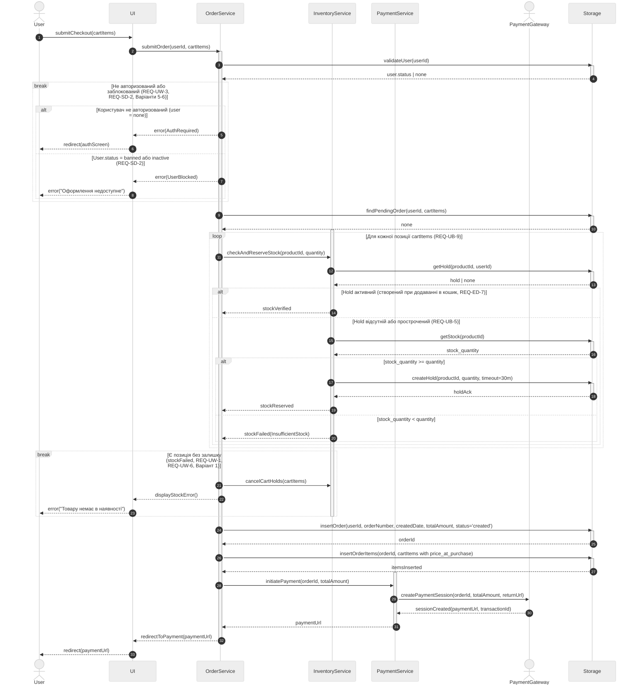
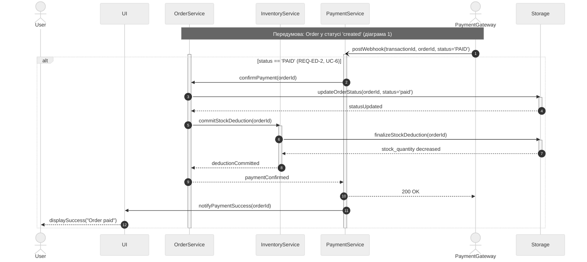
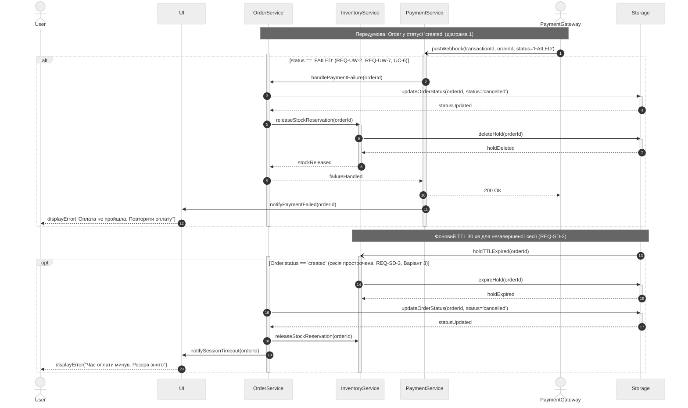
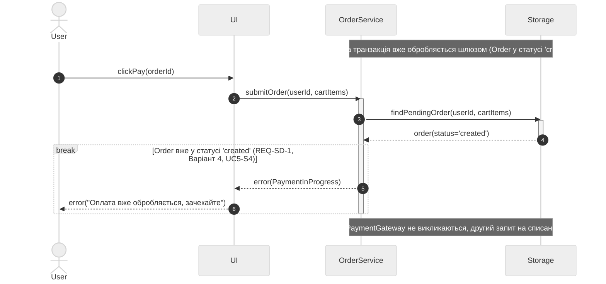
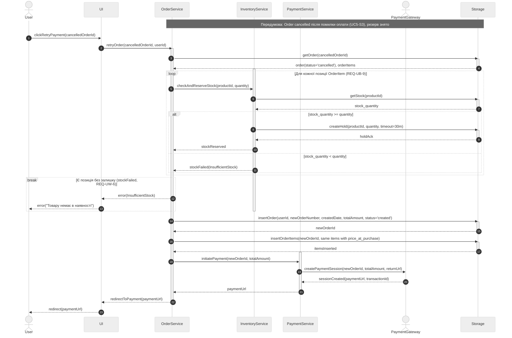
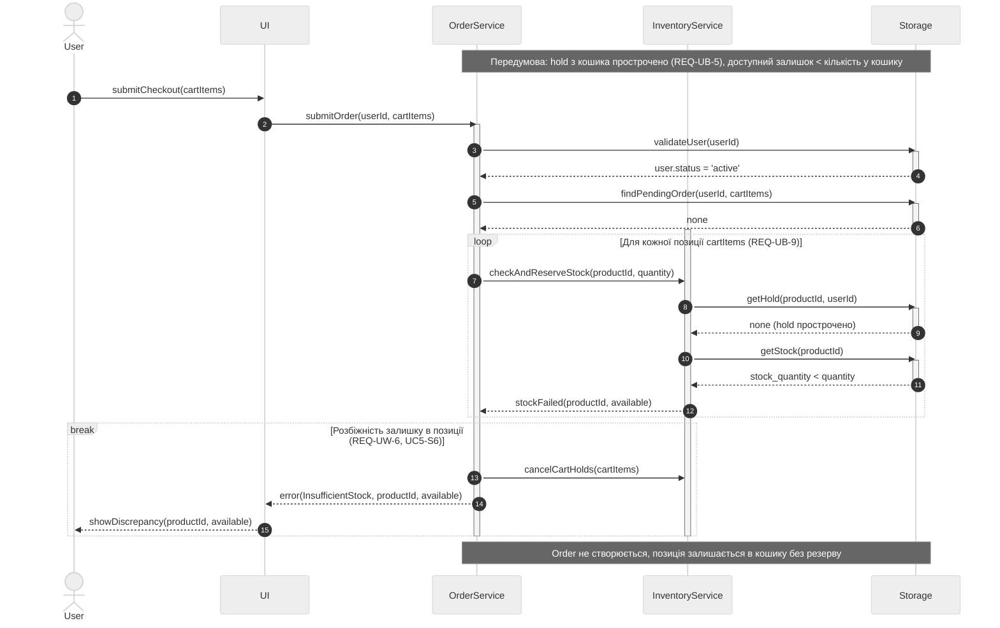

## Sequence діаграми за сценаріями UC-5 «Оформити замовлення»

UC-6 «Обробити підтвердження оплати» деталізовано в межах UC5-S2 (PAID) та UC5-S3 (FAILED / TTL), див. обґрунтування в `spec.md`, розділ «Покриття UC-6».

| Сценарій | Діаграма |
|---|---|
| UC5-S1 Успішне створення замовлення | Діаграма 1 |
| UC5-S2 Успішне проведення оплати (UC-6, PAID) | Діаграма 2 |
| UC5-S3 Помилка оплати / TTL (UC-6, FAILED) | Діаграма 3 |
| UC5-S4 Блокування повторного списання | Діаграма 4 |
| UC5-S5 Повторна оплата після помилки | Діаграма 5 |
| UC5-S6 Недостатній залишок під час оформлення | Діаграма 6 |

### Діаграма 1. UC5-S1: Успішне створення замовлення

### Діаграма 2. UC5-S2: Успішне проведення оплати (UC-6, PAID)

### Діаграма 3. UC5-S3: Помилка оплати або TTL (UC-6, FAILED)

### Діаграма 4. UC5-S4: Блокування повторного списання

### Діаграма 5. UC5-S5: Повторна оплата після помилки

### Діаграма 6. UC5-S6: Недостатній залишок під час оформлення

