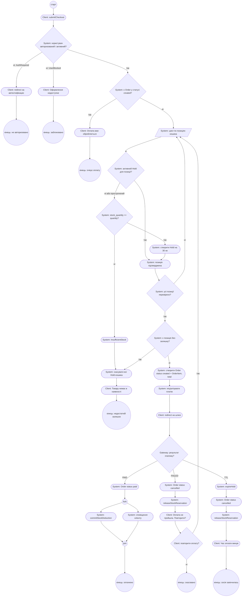

# Activity-діаграма процесу: UC-5 «Оформити замовлення» та UC-6 «Обробити підтвердження оплати»

## Покриття сценаріїв

| Сценарій | Шлях у діаграмі |
|---|---|
| UC5-S1 (успішне створення) | `START` → `D_USER` так → `D_PEND` ні → `L_HOLD` → цикл перевірки hold/залишку → `D_ALL` так → `D_ANYFAIL` ні → `A_CREATEORDER` → `A_INITPAY` → `A_REDIRECT` |
| UC5-S2 (PAID / UC-6) | `D_RESULT` PAID → `A_PAID` → `F1` fork → `A_DEDUCT` ∥ `A_NOTIFY` → `J1` join → `FIN_PAID` |
| UC5-S3 (FAILED / UC-6) | `D_RESULT` FAILED → `A_CANCELLED` → `A_RELEASE` → `A_RETRYOFFER` → `D_RETRY` |
| UC5-S4 (блокування повтору) | `D_PEND` так → `A_PAYING` → `FIN_PAYING` |
| UC5-S5 (повторна оплата) | `D_RETRY` так → `L_HOLD` → повторна перевірка залишку/hold → новий `Order` |
| UC5-S6 (недостатній залишок) | `D_STOCK` ні → `A_STOCKFAIL` → `A_CANCELHOLDS` → `A_NOSTOCK` → `FIN_NOSTOCK` |
| Неавторизований | `D_USER` AuthRequired → `A_AUTH` → `FIN_AUTH` |
| Заблокований | `D_USER` UserBlocked → `A_BLK` → `FIN_BLK` |
| TTL | `D_RESULT` TTL → `A_EXPIREHOLD` → `A_CANCELLED2` → `A_RELEASE2` → `FIN_EXPIRED` |
