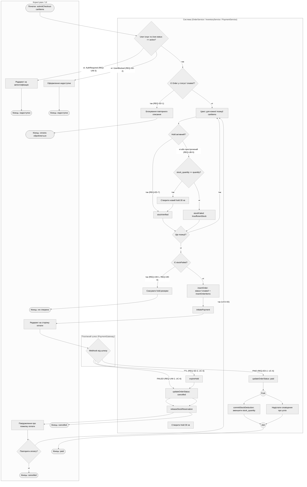

# Activity-діаграма процесу: UC-5 «Оформити замовлення» та UC-6 «Обробити підтвердження оплати»

Джерело: `spec.md` (процес), `lab1` (ERD), `lab2` (UC-5/UC-6), `lab3` (Sequence).

## Покриття сценаріїв

| Сценарій | Покриття в діаграмі |
|---|---|
| UC5-S1 (Успішне створення) | `Start` → `CheckUser` (active) → `CheckPending` (ні) → цикл перевірки hold/залишку → `InsertOrder` → `Redirect` |
| UC5-S2 (Успішна оплата / UC-6 PAID) | `WaitWebhook` (PAID) → `UpdatePaid` → `Fork` (`Deduct`, `NotifyOk`) → `Join` |
| UC5-S3 (Помилка оплати / UC-6 FAILED) | `WaitWebhook` (FAILED) → `UpdateCancel` → `Release` → `NotifyFail` → `Retry` |
| UC5-S4 (Блокування повторного списання) | `CheckPending` (так) → `BlockRep` |
| UC5-S5 (Повторна оплата після помилки) | `Retry` (так) → `Loop` (повторна перевірка залишку) → створення нового `Order` |
| UC5-S6 (Недостатній залишок) | `StockCheck` (ні) → `Insufficient` → `CancelHolds` |