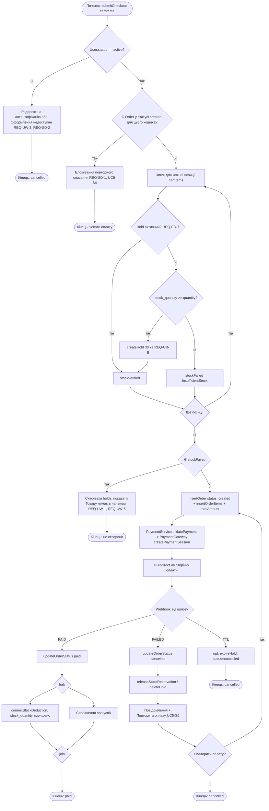

# Activity-діаграма процесу: UC-5 «Оформити замовлення» та UC-6 «Обробити підтвердження оплати»

Джерело: `spec.md` (процес), `lab3` (sequence), `lab2` (UC-5/UC-6 сценарії), `lab1` (ERD).



## Покриття сценаріїв

| Сценарій | Вузол діаграми |
|---|---|
| UC5-S1 | VU → Pending → Loop → InsertOrder → Redirect |
| UC5-S2 | WaitWebhook → PAID → Deduct |
| UC5-S3 | WaitWebhook → FAILED → Release |
| UC5-S4 | Pending → Block |
| UC5-S5 | Retry → InsertOrder |
| UC5-S6 | Stock → Insufficient |
```<|end|><|start|> fileList=write xml<|message|><rfl:parameter name="path">
D:/МАВПЗ/lab4/DEFENSE.md