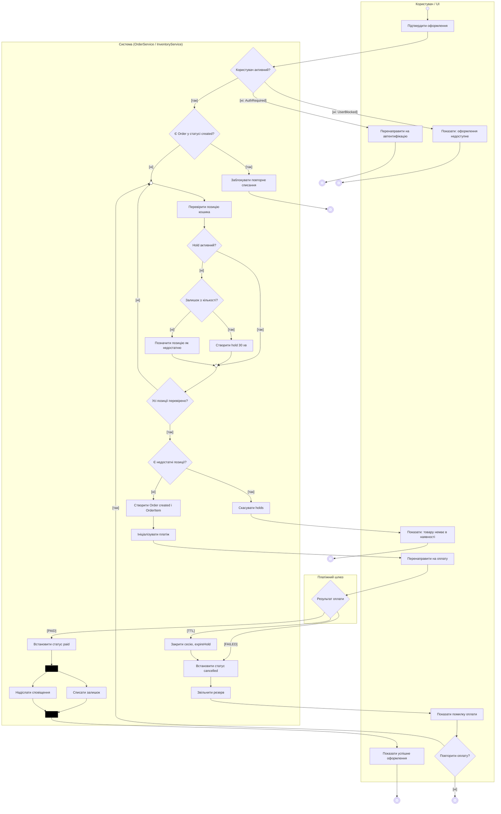

# Activity-діаграма процесу: UC-5 «Оформити замовлення» та UC-6 «Обробити підтвердження оплати»

Джерело: `spec.md` (процес), `lab1` (ERD), `lab2` (UC-5/UC-6), `lab3` (Sequence).

Позначення: один початковий вузол, дії — дієслівні фрази, умови в `[дужках]` на кожному виході з ромба, `merge` (●) для злиття альтернатив, `fork/join` (чорна смуга) для паралельних дій, доріжки — ролі.

## Покриття сценаріїв

| Сценарій | Шлях у діаграмі |
|---|---|
| UC5-S1 (успішне створення) | `start` → `a1` → `dUser [так]` → `dPend [ні]` → `mLoop` → цикл перевірки → `dFail [ні]` → `aOrder` → `aPay` → `a2` → `dWh` |
| UC5-S2 (PAID / UC-6) | `dWh [PAID]` → `aPaid` → `fork1` → `aDeduct` ∥ `aNotify` → `join1` → `aOk` |
| UC5-S3 (FAILED / UC-6) | `dWh [FAILED]` → `aCancel` → `aRelease` → `a3` → `dRetry` |
| UC5-S4 (блокування повтору) | `dPend [так]` → `aBlock` |
| UC5-S5 (повторна оплата) | `dRetry [так]` → `mLoop` → повторна перевірка залишку → новий `Order` |
| UC5-S6 (недостатній залишок) | `dStock [ні]` → `aShort` → `dAll` → `dFail [так]` → `aRelease0` → `aNoStock` |
| Неавторизований (REQ-UW-3) | `dUser [ні: AuthRequired]` → `aAuth` |
| Заблокований (REQ-SD-2) | `dUser [ні: UserBlocked]` → `aBlk` |
| TTL (REQ-SD-3) | `dWh [TTL]` → `aExpire` → `aCancel` → `aRelease` |
