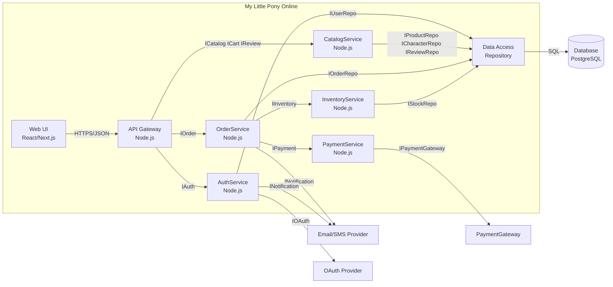

# UML Component Diagram — архітектура платформи «My Little Pony Online»

Межа системи: усе всередині `My Little Pony Online` — наша платформа; `PaymentGateway`, `Email/SMS Provider`, `OAuth Provider` і `Database` — зовнішні інтеграції.

## Покриття компонентів

- Web UI → UC-1…UC-7 (lab2) → взаємодія (lab3)
- OrderService / InventoryService / PaymentService → UC-5/UC-6 (lab2) → Sequence (lab3) → процес (lab4)
- Data Access / Database → ERD (lab1)
- PaymentGateway / Email/SMS / OAuth → актори (lab2) → UC-6 (lab3)
